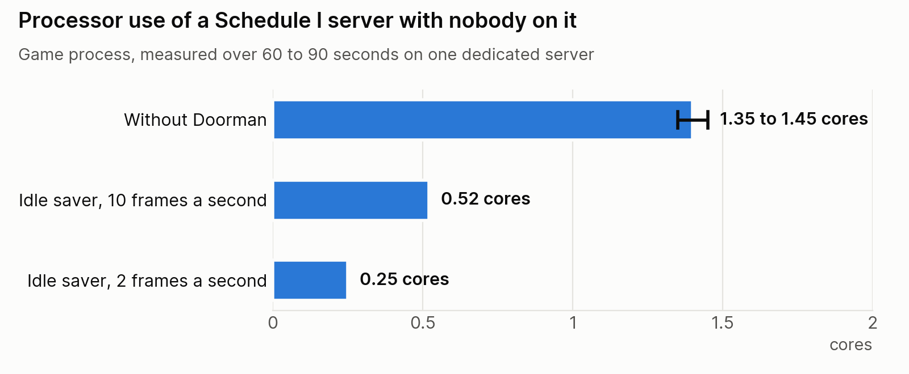

# Doorman

[](LICENSE)
[](https://store.steampowered.com/app/3164500/)
[](https://github.com/ifBars/S1DedicatedServers)

A Schedule I dedicated server sits at full speed all day with nobody on it, and anyone who has
the address can join, because S1DedicatedServers 1.1.5 does not check the server password when
a player joins. Doorman is a small
server add-on for [S1DedicatedServers](https://github.com/ifBars/S1DedicatedServers) that fixes
both: an idle saver that cuts the empty server's processor use, an invited-players-only list
(an allow list, or whitelist, checked against the Steam ID Steam confirmed), and a live status
file that other tools can read.

It runs on the server only. Players install nothing for it.

Doorman is third-party software and is not made or endorsed by TVGS, the developers of
Schedule I. If you would rather rent a server than run one,
[SurvivalServers.com](https://www.survivalservers.com/services/game_servers/schedule_i/?utm_source=github&utm_medium=readme&utm_campaign=doorman)
hosts Schedule I servers.

## What it does

Three things, each with its own switch in the settings file.

| Switch | Starts | What it does |
|---|---|---|
| Idle saver | off | While nobody is connected, the server runs at a low frame rate (10 a second unless you set another) instead of the mod's 60. The moment a connection starts it is back at full speed. |
| Live feed | on | Every few seconds writes a one-line JSON file: in-game day and time, last save time, and each connected player's name, Steam ID, time connected and place on the map (x, z). |
| Invited players only | off | A list of Steam IDs. When it is on, a player who is not on the list is disconnected with a plain message. |

It never gives items or cash, never moves a player and never touches a quest.

Measured on one server with nobody connected (processor time of the game process over 60 to 90
seconds): 1.35 to 1.45 cores without Doorman, 0.52 with the idle saver at 10 frames a second,
and 0.25 at 2.

<picture>
  <source media="(prefers-color-scheme: dark)" srcset="docs/img/idle-saver-dark.png">
  
</picture>

## What you need

- A Schedule I dedicated server on S1DedicatedServers **1.1.5**, the IL2CPP server build, with
  MelonLoader 0.7.2.
- Schedule I **0.4.7f12**. Doorman is built against one game build and one mod release; after
  either changes, rebuild it (see "Building").

## Install

1. Download `Doorman-v<version>.zip` from the
   [latest release](https://github.com/HumanGenome/Doorman/releases/latest), or build it.
2. Copy `Mods/Doorman.dll` into the server's `Mods` folder, next to
   `DedicatedServerMod_Il2cpp_Server.dll`. `Doorman-LICENSE.txt` can go beside it.
3. Restart the server. The log (`MelonLoader\Latest.log`) shows, after the mod's
   `DEDICATED SERVER READY` line:

   ```
   [Doorman] Ready. idle saver off, live feed ON (every 5s), invited players only off.
   ```

To remove it, delete `Mods\Doorman.dll` and restart. `UserData\Doorman.json` and
`UserData\Doorman.live.json` can go too.

## Settings

`UserData\Doorman.json` in the server folder. Doorman reads it at start and again within 5
seconds whenever it changes, so a change applies without a restart. With no file, the idle
saver and invited-only are off and the feed is on.

```json
{"version":1,
 "idleSaver":{"enabled":true,"frameRate":10,"graceSeconds":15},
 "liveFeed":{"enabled":true,"intervalSeconds":5},
 "invitedOnly":{"enabled":false,"steamIds":["76561198000000001"],"message":"Private server."}}
```

Limits Doorman keeps whatever the file says: idle frame rate 2 to 60, quiet stretch 0 to 600
seconds, feed every 2 to 60 seconds, at most 500 invited IDs, IDs must be 17 digits starting
7656119, message one line of at most 200 characters. A switch is on for `true` or `"on"`. A
file that is not valid JSON is refused, and the settings already in use are kept; the log says
why.

## How each one works

**Idle saver.** Doorman never changes the game's or the mod's frame rate setting. At the end of
each frame, while it judges the server idle, it waits out the rest of a longer frame (100 ms at
10 a second). Back to full speed simply means it stops waiting, so nothing can be left slow by
a missed step. Idle means all of these: the switch is on, the server has finished starting, no
connection exists, no save is running, and a quiet stretch (15 seconds unless you set another)
has passed. The wake-up is the network layer's own "remote connection started" signal
(`ServerManager.OnRemoteConnectionState`), which fires before the Steam check and the
handshake. Once a second Doorman also recounts the connections from the mod's player list, so
a missed signal cannot leave the server slow with somebody on it. If it cannot listen for that
signal, it never slows the server, and says so in the log.

**Live feed.** `UserData\Doorman.live.json`, one line of JSON, replaced whole each time
(written to `Doorman.live.json.tmp`, then renamed over the old file). No port, no listener, no
file that grows, and the disk write happens off the game thread. A reader should treat a file
whose `written` time is more than about 30 seconds old as "not running".

```json
{"format":1,"addon":"1.0.3","written":"2026-10-09T18:38:08Z","writtenUnix":1791571088,
 "ready":"2026-10-09T18:36:17Z",
 "clock":{"available":true,"day":1,"hour":7,"minute":0,"time":"07:00"},
 "lastSave":{"files":"2026-10-09T18:35:58Z","reported":null},
 "playerCount":0,"maxPlayers":16,
 "players":[{"name":"...","steamId":"7656119...","connected":"...Z","seconds":125,"joined":true,"x":-12.3,"z":45.7}],
 "frameRate":{"idleSaver":true,"idleNow":true,"idleLimit":10,"normalLimit":60,"measured":9.9},
 "invitedOnly":{"on":false,"checking":false,"listed":0}}
```

- `lastSave.files` is the newest write time among the save folder's own top-level files, so it
  is right across restarts. `lastSave.reported` is when the mod last told add-ons that a save
  finished in this run.
- `players[].joined` is false while a player is still being let in. `x` and `z` are null until
  the player's character exists.
- `frameRate.measured` is the frames actually counted since the previous write.
- The feed says how many IDs are on the invited list, never the list itself.
- `invitedOnly.checking` is true only while the list is on and its check is running. If the check
  fails, or the mod has no player list to look at, it turns false and the log says why, so
  a reader should not take `on` alone to mean players are being checked.

**Invited players only.** Checked four times a second for every connection the mod lists, with
one decision per connection: a later change to the list does not remove somebody who is already
in. A player still in the Steam check is left alone (the mod ends that itself if it takes too
long). Only the ID that Steam confirmed is trusted, never the one the player's own game reports.
That needs the mod's Steam authentication on, in `server_config.toml`:

```toml
[authentication]
authProvider = "SteamGameServer"
```

Without it there is no confirmed ID, the reported one is all there is, and a player can fake
that. The message a turned-away player sees can be set in the settings file; the default is
"This server is for invited players only. Ask the owner to add your Steam ID to the invited
list."

## What has been tested

On a dedicated server with nobody on it: the add-on loads cleanly next to the mod, the feed
follows the game's clock and saves, a save at idle brings the server back to full speed, a
setting change applies within 5 seconds without a restart, a stop at 2 frames a second still
saves the world first, and a network-level connection brought the server back to full speed
13 milliseconds after it opened (`tools/ConnectProbe`, below). The settings reader, the invited-list decision, the
idle rule, the feed and the failure lines are covered by 165 unit checks.

Not yet tested with a real player joining: a full join with the idle saver on, invited-only
turning the right person away and letting an invited one in, and the positions in the feed.
Reports are welcome in [Issues](https://github.com/HumanGenome/Doorman/issues).

## Building

Needs the .NET 8 SDK (Doorman builds for `net6.0`, the runtime MelonLoader gives IL2CPP mods),
`zip`, and `strings`.

1. Copy three things from a Schedule I server folder into one folder outside this repository:
   `MelonLoader\net6\`, `MelonLoader\Il2CppAssemblies\` and
   `Mods\DedicatedServerMod_Il2cpp_Server.dll`. They belong to the game and the mod: never
   commit or publish them.
2. `cp local.build.props.example local.build.props` and point `S1GameFiles` at that folder.
3. `./build.sh` runs the tests, builds, checks the DLL (the version is baked in, no build-machine
   path, no client companion) and packs `dist/Doorman-v<version>.zip`. The same source gives
   the same zip, byte for byte.

Tests alone: `dotnet run --project tests/Doorman.Tests`. They compile Doorman's own logic
without the game, MelonLoader or the mod.

`tools/ConnectProbe` opens one connection to a game server at the network layer and holds it,
the way a joining game does in its first instant. It cannot log in and never becomes a player.
It is how the idle saver's wake-up can be watched from the server side:
`dotnet run --project tools/ConnectProbe -- <ip> <port> 25`.

After a game or mod update: copy the new files (step 1), rebuild, run the tests, raise the
version in `src/Doorman/DoormanMod.cs` and `src/Doorman/Doorman.csproj`, and boot a test server
before any other server gets it.

## Licence

Doorman links to S1DedicatedServers, which is GPLv3, so Doorman is GPL-3.0-or-later
([`LICENSE`](LICENSE), [`NOTICE.txt`](NOTICE.txt)). Security reports: [SECURITY.md](SECURITY.md).
