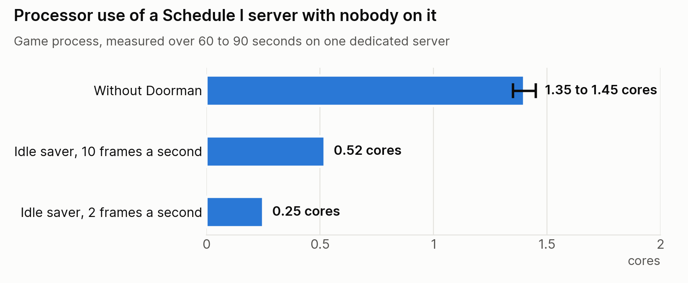

# Doorman

[](LICENSE)
[](https://github.com/ifBars/S1DedicatedServers)
[](https://store.steampowered.com/app/3164500/)
[](#features)

On S1DedicatedServers 1.1.6, anyone who has a Schedule I dedicated server's address can join it: the mod doesn't check the server password when a player joins. An empty server also runs at full speed all day. Doorman adds a whitelist that goes by the Steam ID Steam confirmed, lowers CPU use while the server is empty, and writes a status file your own tools can read. It runs on the server only, so players install nothing.

_Doorman is a community project and is not affiliated with or endorsed by TVGS, the developers of Schedule I._

## Contents

- [Features](#features)
- [Install](#install)
- [Settings](#settings)
- [What has been tested](#what-has-been-tested)
- [Building](#building)
- [Getting help](#getting-help)
- [Contributing](#contributing)
- [License](#license)
- [Credits](#credits)

## Features

Each one has its own switch in the settings file. Doorman never gives items or cash, never moves a player and never touches a quest.

### Whitelist

Off until you turn it on. A player whose Steam ID isn't on the whitelist is disconnected and sees "Not on the whitelist" with a message you can set. The default message is "Ask the server owner to add your Steam ID to the whitelist."

Only the ID that Steam confirmed counts, never the one the player's own game reports. That needs the mod's Steam authentication, which is on unless you changed it in `server_config.toml`:

```toml
[authentication]
authProvider = "SteamGameServer"
```

Without it, the only ID is the one the player's own game reports, and a player can fake that. Doorman warns about this in the log.

Taking a player off the whitelist doesn't remove them while they're on. They're turned away the next time they join. A player who is still connected 3 seconds after being turned away is disconnected.

### Lower CPU on an empty server

Off until you turn it on. While nobody is connected, the server runs at 10 frames a second instead of the mod's 60 (you can set another rate). It's back at full speed the moment someone connects.

Measured on one empty server over 60 to 90 seconds: 1.35 to 1.45 CPU cores without Doorman, 0.52 at 10 frames a second, and 0.25 at 2.

<picture>
  <source media="(prefers-color-scheme: dark)" srcset="docs/img/idle-saver-dark.png">
  
</picture>

Doorman never changes the game's or the mod's frame rate setting. It slows the server only after it has finished starting, no save is running and nobody has been connected for 15 seconds (you can set another wait). It also recounts players every second, so the server never stays slow with someone on. If Doorman can't watch for new connections, it never slows the server and says so in the log.

The details: [How the idle saver works](docs/how-it-works.md).

### Status file for your own tools

On unless you turn it off. Every 5 seconds (you can set another interval) Doorman rewrites `UserData\Doorman.live.json`, one line of JSON: the in-game day and time, the last save time, and each connected player's name, Steam ID, time connected and position on the map (x, z). It opens no port and the file never grows. If its `written` time is older than about three intervals, treat the server as not running.

```json
{"format":1,"addon":"1.0.4","written":"2026-10-09T18:38:08Z","writtenUnix":1791571088,
 "ready":"2026-10-09T18:36:17Z",
 "clock":{"available":true,"day":1,"hour":7,"minute":0,"time":"07:00"},
 "lastSave":{"files":"2026-10-09T18:35:58Z","reported":null},
 "playerCount":1,"maxPlayers":16,
 "players":[{"name":"Player","steamId":"76561198000000001","connected":"2026-10-09T18:36:33Z","seconds":95,"joined":true,"x":-12.3,"z":45.7}],
 "frameRate":{"idleSaver":true,"idleNow":false,"idleLimit":10,"normalLimit":60,"measured":59.9},
 "invitedOnly":{"on":true,"checking":true,"listed":1}}
```

That's one player connected and on the whitelist. With nobody connected, `players` is `[]`, and once the quiet stretch has passed `idleNow` turns true and `measured` drops to about the idle limit.

- `lastSave.files` is the newest write time among the save folder's own top-level JSON files, so it is right across restarts. `lastSave.reported` is when the mod last told add-ons that a save finished in this run. A failed save does not move it.
- `players[].steamId` is empty until Steam has confirmed the player, on a server that asks Steam. `joined` is false while a player is still being let in. `x` and `z` are null until the player's character exists.
- `frameRate.measured` is the frames actually counted since the previous write.
- The file says how many IDs are on the whitelist, never the list itself.
- `invitedOnly.checking` is true only while the whitelist is on and its check is running. If the check stops working, or the mod has no player list to look at, it turns false and the log says why. So don't take `on` alone to mean players are being checked.

## Install

### Rent a server

[SurvivalServers.com](https://www.survivalservers.com/services/game_servers/schedule_i/?utm_source=github&utm_medium=readme&utm_campaign=doorman) runs Schedule I servers with Doorman ready to switch on.

### Install on your server

You need a Schedule I dedicated server on S1DedicatedServers **1.1.6**, the IL2CPP server build, with MelonLoader 0.7.2, on Schedule I **0.4.7f12**. Doorman is built for one game version and one mod release. After either one updates, rebuild it (see [Building](#building)).

1. Download `Doorman-v<version>.zip` from the [latest release](https://github.com/HumanGenome/Doorman/releases/latest), or build it.
2. Copy `Mods/Doorman.dll` into the server's `Mods` folder, next to `DedicatedServerMod_Il2cpp_Server.dll`. `Doorman-LICENSE.txt` can go beside it.
3. Restart the server. The log (`MelonLoader\Latest.log`) shows, after the mod's `DEDICATED SERVER READY` line:

   ```
   [Doorman] Ready. idle saver off, status file ON (every 5s), whitelist off.
   ```

To remove it, delete `Mods\Doorman.dll` and restart. `UserData\Doorman.json` and `UserData\Doorman.live.json` can go too.

## Settings

`UserData\Doorman.json` in the server folder. Doorman reads it at start and again within 5 seconds of any change, so a change applies without a restart. With no file, the idle saver and the whitelist are off and the status file is on. If the file isn't valid JSON, Doorman keeps the settings it already uses (or the defaults at start) and says why in the log.

```json
{"idleSaver":{"enabled":true,"frameRate":10,"graceSeconds":15},
 "liveFeed":{"enabled":true,"intervalSeconds":5},
 "invitedOnly":{"enabled":false,"steamIds":["76561198000000001"],"message":"Private server."}}
```

| Setting | Default and limits |
|---|---|
| `idleSaver.enabled` | Off. `true` or `"on"` turns a switch on |
| `idleSaver.frameRate` | 10, from 2 to 60 frames a second |
| `idleSaver.graceSeconds` | 15, from 0 to 600 seconds |
| `liveFeed.enabled` | On |
| `liveFeed.intervalSeconds` | 5, from 2 to 60 seconds |
| `invitedOnly.enabled` | Off. With nobody on the list it turns everybody away |
| `invitedOnly.steamIds` | Empty. At most 500, each a 17-digit Steam ID (SteamID64) |
| `invitedOnly.message` | See [Whitelist](#whitelist). One line of at most 200 characters |

## What has been tested

On a dedicated server with nobody on it: Doorman loads next to the mod, the status file follows the game's clock and saves, a save while idle brings the server back to full speed, a settings change applies within 5 seconds without a restart, a stop at 2 frames a second still saves the world first, and a new connection brought the server back to full speed 13 milliseconds after it opened (`tools/ConnectProbe`, below). 223 unit tests cover the settings reader, the whitelist decision, the idle rule, the status file and the log lines.

Not tested yet with a real player: a full join with the idle saver on, the whitelist turning away the right player and letting a listed one in, and the positions in the status file. Tell us how it goes in [Issues](https://github.com/HumanGenome/Doorman/issues).

## Building

Needs the .NET 10 SDK (Doorman builds for `net6.0`, the runtime MelonLoader gives IL2CPP mods), `zip`, and `strings`.

1. Copy three things from a Schedule I server folder into one folder outside this repository: `MelonLoader\net6\`, `MelonLoader\Il2CppAssemblies\` and `Mods\DedicatedServerMod_Il2cpp_Server.dll`. They belong to the game and the mod: never commit or publish them.
2. `cp local.build.props.example local.build.props` and point `S1GameFiles` at that folder.
3. `./build.sh` runs the tests, builds, checks the DLL (the version is baked in, no build-machine path, no client companion) and packs `dist/Doorman-v<version>.zip`. The same source gives the same zip, byte for byte.

Tests alone: `dotnet run --project tests/Doorman.Tests`. They compile Doorman's own logic without the game, MelonLoader or the mod.

`tools/ConnectProbe` opens one connection to a game server at the network layer and holds it, the way a joining game does in its first instant. It cannot log in and never becomes a player. It is how the idle saver's wake-up can be watched from the server side: `dotnet run --project tools/ConnectProbe -- <ip> <port> 25`.

After a game or mod update: copy the new files (step 1), rebuild, run the tests, raise the version in `src/Doorman/DoormanMod.cs` and `src/Doorman/Doorman.csproj`, and boot a test server before any other server gets it.

## Getting help

Bugs and questions about Doorman go in [Issues](https://github.com/HumanGenome/Doorman/issues), with `MelonLoader\Latest.log` if you can. Security reports go through [SECURITY.md](SECURITY.md). Problems with the dedicated server itself belong with [S1DedicatedServers](https://github.com/ifBars/S1DedicatedServers). Hosting questions go to your provider.

## Contributing

Pull requests are welcome. `dotnet run --project tests/Doorman.Tests` needs no game files and must pass; GitHub runs it on every push and pull request. New logic goes in `src/Doorman/Core` with checks beside the others.

## License

Doorman links to S1DedicatedServers, which is GPLv3, so Doorman is GPL-3.0-or-later ([`LICENSE`](LICENSE), [`NOTICE.txt`](NOTICE.txt)).

## Credits

Built on [S1DedicatedServers](https://github.com/ifBars/S1DedicatedServers) by ifBars and [MelonLoader](https://github.com/LavaGang/MelonLoader).
