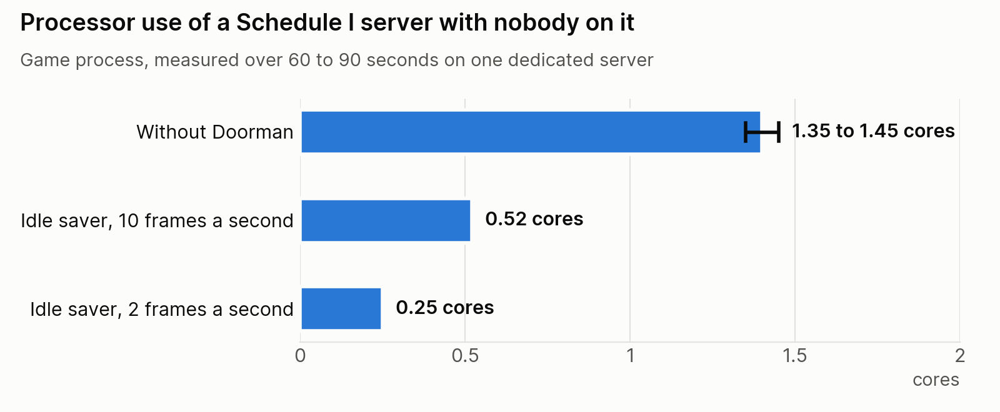

# Doorman

[](LICENSE)
[](https://github.com/ifBars/S1DedicatedServers)
[](https://store.steampowered.com/app/3164500/)
[](#features)

Anyone who has the address of a Schedule I dedicated server can join it, because S1DedicatedServers 1.1.6 does not check the server password when a player joins. An empty server also runs at full speed all day. Doorman adds a whitelist checked against the Steam ID that Steam confirmed, an idle saver that cuts an empty server's processor use, and a status file your own tools can read. It runs on the server only, so players install nothing extra.

_Doorman is a community project and is not affiliated with or endorsed by TVGS, the developers of Schedule I._

## Table of Contents

- [Features](#features)
- [Install](#install)
- [Settings](#settings)
- [What has been tested](#what-has-been-tested)
- [Building](#building)
- [Getting help](#getting-help)
- [Contributing](#contributing)
- [License](#license)
- [Credits](#credits)

## Features

Each one has its own switch in the settings file. Doorman never gives items or cash, never moves a player and never touches a quest.

### Whitelist

Off until you turn it on. A list of Steam IDs: a player who is not on it is disconnected with a message you can set. The default message is "This server is for invited players only. Ask the owner to add your Steam ID to the invited list."

Only the ID that Steam confirmed counts, never the one the player's own game reports. That needs the mod's Steam authentication, which is on unless you changed it in `server_config.toml`:

```toml
[authentication]
authProvider = "SteamGameServer"
```

Without it there is no confirmed ID, the reported one is all there is, and a player can fake that. Doorman says so in the log.

Doorman checks every connection the mod lists four times a second and makes one decision per connection, so taking someone off the list does not remove them while they are in. A player still in the Steam check is left alone (the mod ends that itself if it takes too long). A player turned away who is still connected 3 seconds later has the connection closed directly.

### Lower CPU on an empty server

Off until you turn it on. While nobody is connected, the server runs at a low frame rate (10 a second unless you set another) instead of the mod's 60. The moment a connection starts it is back at full speed.

Measured on one server with nobody connected (processor time of the game process over 60 to 90 seconds): 1.35 to 1.45 cores without Doorman, 0.52 with the idle saver at 10 frames a second, and 0.25 at 2.

<picture>
  <source media="(prefers-color-scheme: dark)" srcset="docs/img/idle-saver-dark.png">
  
</picture>

Doorman never changes the game's or the mod's frame rate setting. At the end of each frame, while it judges the server idle, it waits out the rest of a longer frame (100 ms at 10 a second), so going back to full speed only means it stops waiting. Idle means all of these: the switch is on, the server has finished starting, no connection exists, no save is running, and a quiet stretch (15 seconds unless you set another) has passed. The wake-up is the network layer's own "remote connection started" signal (`ServerManager.OnRemoteConnectionState`), which fires before the Steam check and the handshake. Once a second Doorman also recounts the connections from the mod's player list, so a missed signal cannot leave the server slow with somebody on it. If it cannot listen for that signal, it never slows the server, and says so in the log.

### Status file for your own tools

On unless you turn it off. Every few seconds Doorman replaces `UserData\Doorman.live.json`, one line of JSON: in-game day and time, last save time, and each connected player's name, Steam ID, time connected and place on the map (x, z). No port, no listener, no file that grows, and the disk write happens off the game thread. Read it as "not running" when its `written` time is older than about three feed intervals.

```json
{"format":1,"addon":"1.0.4","written":"2026-10-09T18:38:08Z","writtenUnix":1791571088,
 "ready":"2026-10-09T18:36:17Z",
 "clock":{"available":true,"day":1,"hour":7,"minute":0,"time":"07:00"},
 "lastSave":{"files":"2026-10-09T18:35:58Z","reported":null},
 "playerCount":1,"maxPlayers":16,
 "players":[{"name":"Player","steamId":"76561198000000001","connected":"2026-10-09T18:36:33Z","seconds":95,"joined":true,"x":-12.3,"z":45.7}],
 "frameRate":{"idleSaver":true,"idleNow":false,"idleLimit":10,"normalLimit":60,"measured":59.9},
 "invitedOnly":{"on":true,"checking":true,"listed":1}}
```

That is one player connected and on the invited list. With nobody connected, `players` is `[]`, and once the quiet stretch has passed `idleNow` turns true and `measured` drops to about the idle limit.

- `lastSave.files` is the newest write time among the save folder's own top-level JSON files, so it is right across restarts. `lastSave.reported` is when the mod last told add-ons that a save finished in this run. A failed save does not move it.
- `players[].steamId` is empty until Steam has confirmed the player, on a server that asks Steam. `joined` is false while a player is still being let in. `x` and `z` are null until the player's character exists.
- `frameRate.measured` is the frames actually counted since the previous write.
- The file says how many IDs are on the invited list, never the list itself.
- `invitedOnly.checking` is true only while the list is on and its check is running. If the check fails, or the mod has no player list to look at, it turns false and the log says why, so do not take `on` alone to mean players are being checked.

## Install

### Rent a server

[Schedule I server hosting from Survival Servers](https://www.survivalservers.com/services/game_servers/schedule_i/?utm_source=github&utm_medium=readme&utm_campaign=doorman) comes with Doorman: turn on invited players only in the control panel.

### Install on your server

You need a Schedule I dedicated server on S1DedicatedServers **1.1.6**, the IL2CPP server build, with MelonLoader 0.7.2, on Schedule I **0.4.7f12**. Doorman is built against one game build and one mod release; after either changes, rebuild it (see [Building](#building)).

1. Download `Doorman-v<version>.zip` from the [latest release](https://github.com/HumanGenome/Doorman/releases/latest), or build it.
2. Copy `Mods/Doorman.dll` into the server's `Mods` folder, next to `DedicatedServerMod_Il2cpp_Server.dll`. `Doorman-LICENSE.txt` can go beside it.
3. Restart the server. The log (`MelonLoader\Latest.log`) shows, after the mod's `DEDICATED SERVER READY` line:

   ```
   [Doorman] Ready. idle saver off, live feed ON (every 5s), invited players only off.
   ```

To remove it, delete `Mods\Doorman.dll` and restart. `UserData\Doorman.json` and `UserData\Doorman.live.json` can go too.

## Settings

`UserData\Doorman.json` in the server folder. Doorman reads it at start and again within 5 seconds whenever it changes, so a change applies without a restart. With no file, the idle saver and the whitelist are off and the status file is on. A file that is not valid JSON is refused and the log says why: the settings already in use are kept, or the defaults at a start.

```json
{"idleSaver":{"enabled":true,"frameRate":10,"graceSeconds":15},
 "liveFeed":{"enabled":true,"intervalSeconds":5},
 "invitedOnly":{"enabled":false,"steamIds":["76561198000000001"],"message":"Private server."}}
```

| Setting | Starts at, and its limits |
|---|---|
| `idleSaver.enabled` | Off. `true` or `"on"` turns a switch on |
| `idleSaver.frameRate` | 10, from 2 to 60 frames a second |
| `idleSaver.graceSeconds` | 15, from 0 to 600 seconds |
| `liveFeed.enabled` | On |
| `liveFeed.intervalSeconds` | 5, from 2 to 60 seconds |
| `invitedOnly.enabled` | Off. With nobody on the list it turns everybody away |
| `invitedOnly.steamIds` | Empty. At most 500, each 17 digits starting 7656119 |
| `invitedOnly.message` | See [Whitelist](#whitelist). One line of at most 200 characters |

## What has been tested

On a dedicated server with nobody on it: the add-on loads cleanly next to the mod, the status file follows the game's clock and saves, a save at idle brings the server back to full speed, a setting change applies within 5 seconds without a restart, a stop at 2 frames a second still saves the world first, and a network-level connection brought the server back to full speed 13 milliseconds after it opened (`tools/ConnectProbe`, below). The settings reader, the whitelist decision, the idle rule, the status file and the failure lines are covered by 208 unit checks.

Not yet tested with a real player joining: a full join with the idle saver on, the whitelist turning the right person away and letting an invited one in, and the positions in the status file. Reports are welcome in [Issues](https://github.com/HumanGenome/Doorman/issues).

## Building

Needs the .NET 10 SDK (Doorman builds for `net6.0`, the runtime MelonLoader gives IL2CPP mods), `zip`, and `strings`.

1. Copy three things from a Schedule I server folder into one folder outside this repository: `MelonLoader\net6\`, `MelonLoader\Il2CppAssemblies\` and `Mods\DedicatedServerMod_Il2cpp_Server.dll`. They belong to the game and the mod: never commit or publish them.
2. `cp local.build.props.example local.build.props` and point `S1GameFiles` at that folder.
3. `./build.sh` runs the tests, builds, checks the DLL (the version is baked in, no build-machine path, no client companion) and packs `dist/Doorman-v<version>.zip`. The same source gives the same zip, byte for byte.

Tests alone: `dotnet run --project tests/Doorman.Tests`. They compile Doorman's own logic without the game, MelonLoader or the mod.

`tools/ConnectProbe` opens one connection to a game server at the network layer and holds it, the way a joining game does in its first instant. It cannot log in and never becomes a player. It is how the idle saver's wake-up can be watched from the server side: `dotnet run --project tools/ConnectProbe -- <ip> <port> 25`.

After a game or mod update: copy the new files (step 1), rebuild, run the tests, raise the version in `src/Doorman/DoormanMod.cs` and `src/Doorman/Doorman.csproj`, and boot a test server before any other server gets it.

## Getting help

Bugs and questions about Doorman go in [Issues](https://github.com/HumanGenome/Doorman/issues), with `MelonLoader\Latest.log` if you can. Security reports go through [SECURITY.md](SECURITY.md). Problems with the dedicated server itself belong with [S1DedicatedServers](https://github.com/ifBars/S1DedicatedServers). Hosting questions go to your provider.

## Contributing

Pull requests are welcome. `dotnet run --project tests/Doorman.Tests` needs no game files and must pass; GitHub runs it on every push and pull request. New logic goes in `src/Doorman/Core` with checks beside the others.

## License

Doorman links to S1DedicatedServers, which is GPLv3, so Doorman is GPL-3.0-or-later ([`LICENSE`](LICENSE), [`NOTICE.txt`](NOTICE.txt)).

## Credits

Built on [S1DedicatedServers](https://github.com/ifBars/S1DedicatedServers) by ifBars and [MelonLoader](https://github.com/LavaGang/MelonLoader).
